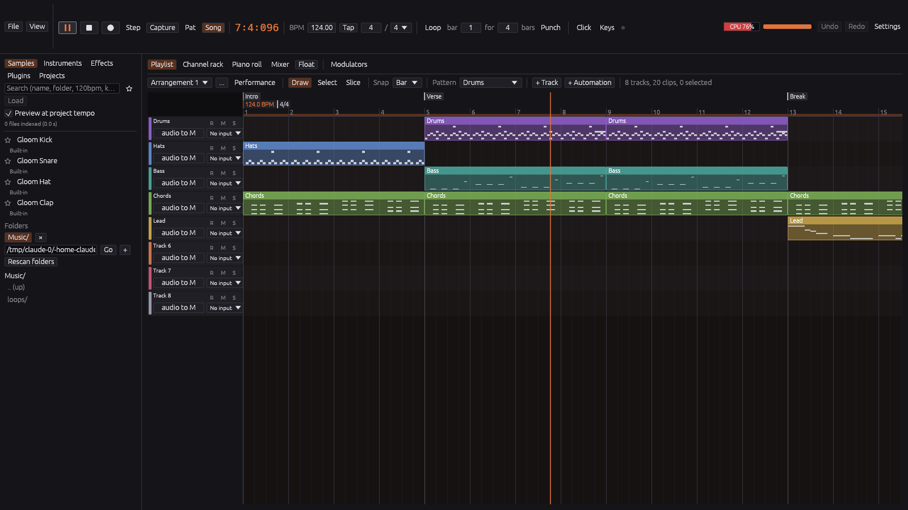
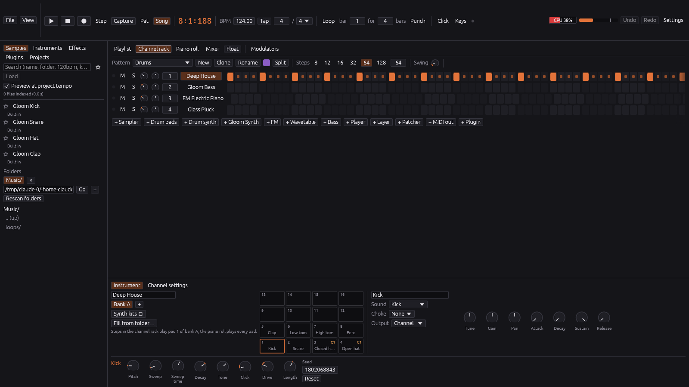
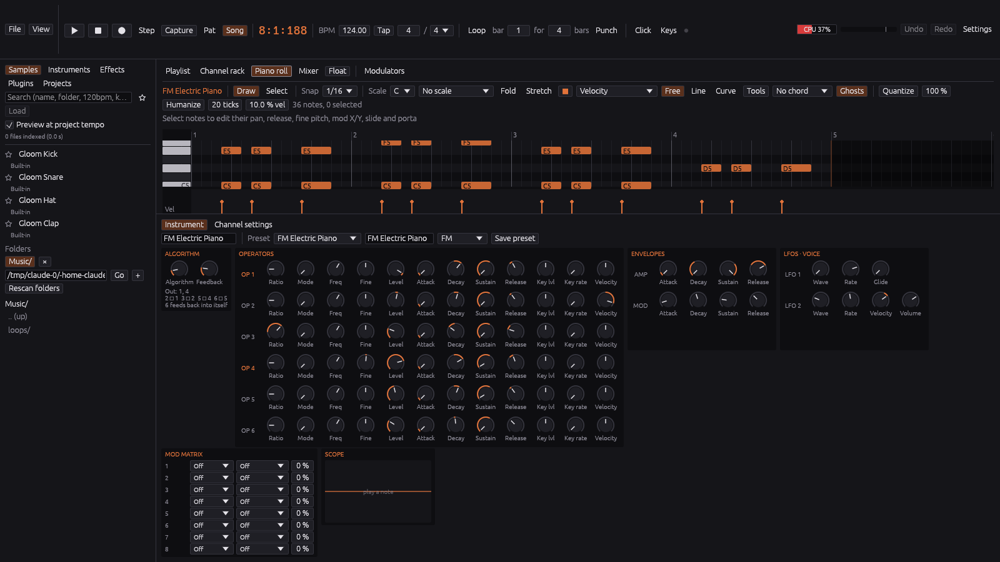
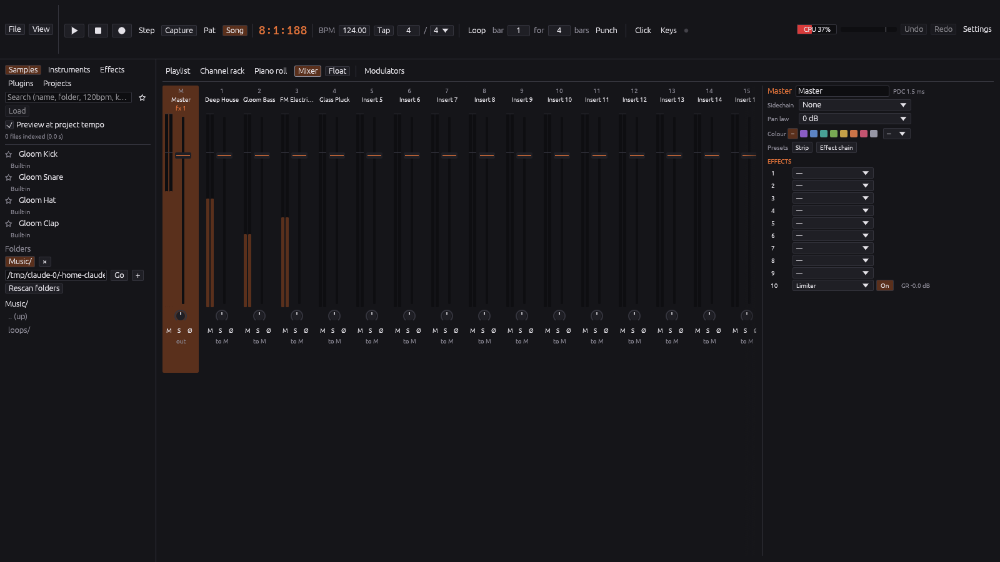
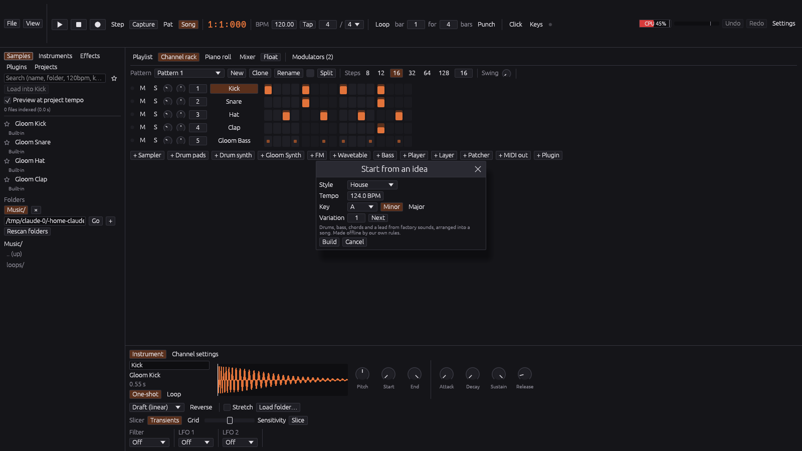
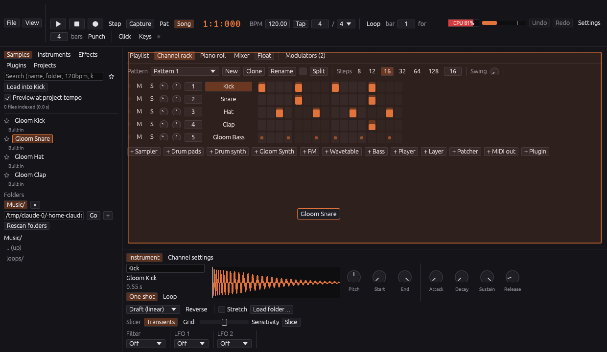

<div align="center">

# GloomTunes Studio

**A pattern-based music studio, written from scratch in Rust.**<br>
Channel rack, piano roll, playlist and mixer in one dark, dense, fast interface.

[](https://github.com/afterdamage/gloomtunes-studio/actions/workflows/ci.yml)
[](https://github.com/afterdamage/gloomtunes-studio/releases)
[](LICENSE)


[Download](https://github.com/afterdamage/gloomtunes-studio/releases) ·
[User guide](docs/USER_GUIDE.md) ·
[Build from source](docs/BUILDING.md) ·
[Architecture](ARCHITECTURE.md) ·
[Roadmap](ROADMAP.md)



</div>

## Why GloomTunes

- **Make a beat in seconds.** Program drums in the step sequencer, write melodies in the piano
  roll, then arrange patterns, audio and automation in the playlist.
- **Real-time safe.** The audio thread never allocates, locks or touches the disk. Timing is
  sample-accurate, and exports sound exactly like playback.
- **Everything built in.** Five synth engines, a sampler, drum machines, a modular patcher and
  21 effects ship with the app. Every sound and preset is original or CC0.
- **Your plugins too.** CLAP and VST3 on every platform, Audio Units on macOS. Crashy plugins can
  run in their own process, so a crash can't take your song down.
- **One codebase, three systems.** Windows 10/11, Ubuntu 22.04+ and macOS 11+, all free under
  the GPL.

## A look inside

<table>
  <tr>
    <td width="50%"><br><sub><b>Channel rack.</b> Step sequencer with per-step velocity, swing and drum pads.</sub></td>
    <td width="50%"><br><sub><b>FM synth and piano roll.</b> Six operators, envelopes, LFOs and a mod matrix, with the chords above.</sub></td>
  </tr>
  <tr>
    <td width="50%"><br><sub><b>Mixer.</b> Up to 256 inserts, sends, sidechains and ten effect slots per strip.</sub></td>
    <td width="50%"><br><sub><b>Start from an idea.</b> Pick a style, tempo and key, and get a 28-bar song to build on.</sub></td>
  </tr>
</table>

<p align="center"><br><sub>Drag anything from the browser onto the rack, mixer or playlist. Click it first to hear a preview.</sub></p>

## Features

| | |
|---|---|
| **Sequencing** | Step sequencer with velocity, pan and pitch per step, swing, layers and key limits. Piano roll with scales, chord stamps, per-note pan, slides and expression, arpeggiator, strum, quantize, humanize and a chord and bass generator. |
| **Arranging** | Playlist with pattern, audio and automation clips, folder tracks, several arrangements per project, markers with jump actions, tempo ramps and a live performance mode. |
| **Instruments** | Gloom Synth with subtractive, FM, wavetable, bass and additive/spectral engines and factory presets. Sampler with key zones and time-stretch, drum pads, a drum synth with kits, a beat slicer and a modular patcher. |
| **Effects** | EQ, compressor, multiband, gate, limiter, clipper, transient shaper, filter, distortion, bitcrusher, delay, reverb, convolution, chorus, flanger, phaser, stereo width, pitch shift, vocoder, stutter and analyzer. Each slot has a mix knob. |
| **Audio** | Multi-input recording with latency compensation, clip fades and crossfades, time-stretch with warp markers, an audio editor, noise reduction, audio to MIDI, and render, consolidate and freeze. |
| **Automation** | Curved automation clips, latch, touch and write recording, LFOs, envelope followers and formula modulators, on every knob and fader. |
| **MIDI** | Any controller, MIDI learn, controller scripts, MPE, pitch bend and sustain, overdub, step record, retro capture, MIDI out to hardware with clock and MTC, and MIDI file import and export. |
| **Export** | WAV, FLAC, Ogg and MP3, per-track or per-insert stems, marker regions and video (with ffmpeg). |
| **Workflow** | Browser with tags, favourites and tempo-matched previews, templates, autosave, undo for everything, custom shortcuts, a theme editor and windows you can float onto a second screen. |

## Install

Grab the latest build from [Releases](https://github.com/afterdamage/gloomtunes-studio/releases).

| System | Package | How |
|---|---|---|
| **Windows 10/11** | `GloomTunes-Studio-<version>-x64-setup.exe` | Run it. No admin rights needed. If SmartScreen warns about an unknown publisher, choose **More info > Run anyway**. |
| **Ubuntu 22.04+** | `gloomtunes-studio_<version>-1_amd64.deb` | `sudo apt install ./gloomtunes-studio_<version>-1_amd64.deb` |
| **Any recent Linux** | `GloomTunes-Studio-<version>-x86_64.AppImage` | `chmod +x` it and run it. |
| **macOS 11+** | `GloomTunes-Studio-<version>-macos-universal.dmg` | Drag the app to Applications. The first time, right-click it and choose **Open > Open**. |

Every file carries a build-provenance attestation. Check one with
`gh attestation verify <file> --repo afterdamage/gloomtunes-studio`.

**Linux audio priority:** the app asks for real-time scheduling for its audio thread. If
Settings > Performance says it was refused, add yourself to the `audio` group
(`sudo usermod -aG audio $USER`, then log out and in) on a system whose
`/etc/security/limits.d` grants that group `rtprio`, or install `rtkit`. Audio plays either way;
real-time priority only makes dropouts under load less likely.

## Build from source

```sh
# Ubuntu: sudo apt install build-essential pkg-config libasound2-dev libudev-dev \
#                          libxkbcommon-dev libwayland-dev libxkbcommon-x11-0
cargo run --release -p gt-app
```

You need stable Rust from [rustup.rs](https://rustup.rs). Windows needs the MSVC toolchain,
macOS the Xcode command line tools. JACK, PipeWire and ASIO are optional features (ASIO needs
the Steinberg SDK, which isn't shipped here). [docs/BUILDING.md](docs/BUILDING.md) has the
details, plus tests, benchmarks, packaging and releases.

## Getting started

Press **Space**. The app opens on a demo song. **F5** to **F9** switch between the playlist,
channel rack, piano roll and mixer. Or choose **File > Start from an idea…** for a fresh song in
your style. The [user guide](docs/USER_GUIDE.md) covers every view and shortcut, and the
**Help** pages inside the app cover the same ground.

## Under the hood

Rust from top to bottom: `cpal` and `midir` for audio and MIDI, `egui` for the interface,
`symphonia`, `rubato` and `hound` for audio files, lock-free `rtrb` queues between the UI and
the engine, and `clack-host` and `vst3` for plugins. The workspace is split into `gt-core`
(the project model), `gt-dsp`, `gt-engine`, `gt-export`, `gt-project`, `gt-plugin-host`,
`gt-ui` and `gt-app`. [ARCHITECTURE.md](ARCHITECTURE.md) explains the design and logs every
decision.

## License

Copyright (C) 2026 Vasil Vasilev.

GloomTunes Studio is free software: you can redistribute it and/or modify it under the terms of
the GNU General Public License as published by the Free Software Foundation, either version 3 of
the License, or (at your option) any later version. See [LICENSE](LICENSE).

The built-in drum sounds are generated by code in `crates/gt-dsp/src/drums.rs`; the audio they
produce is dedicated to the public domain under CC0 1.0.
